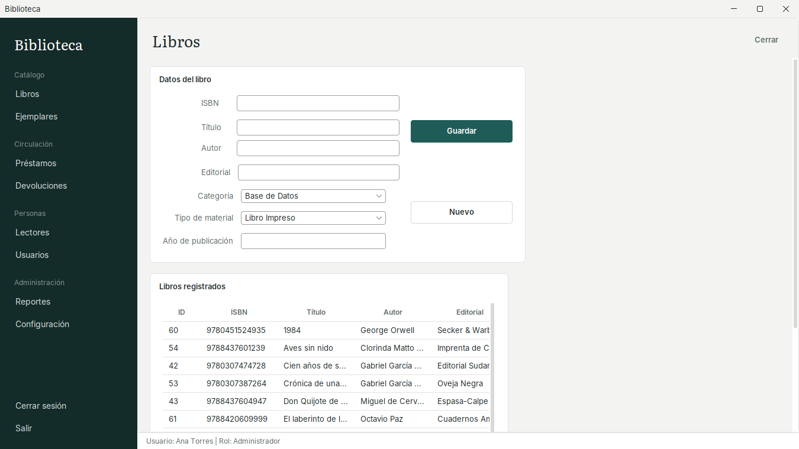
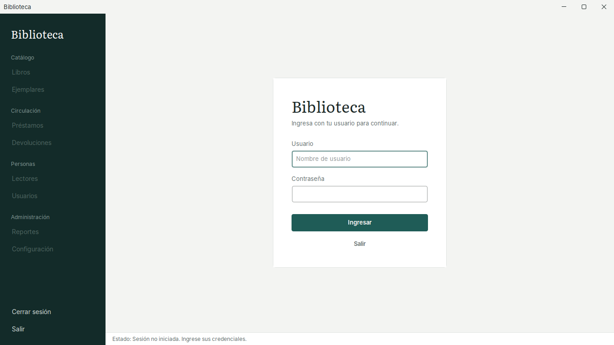
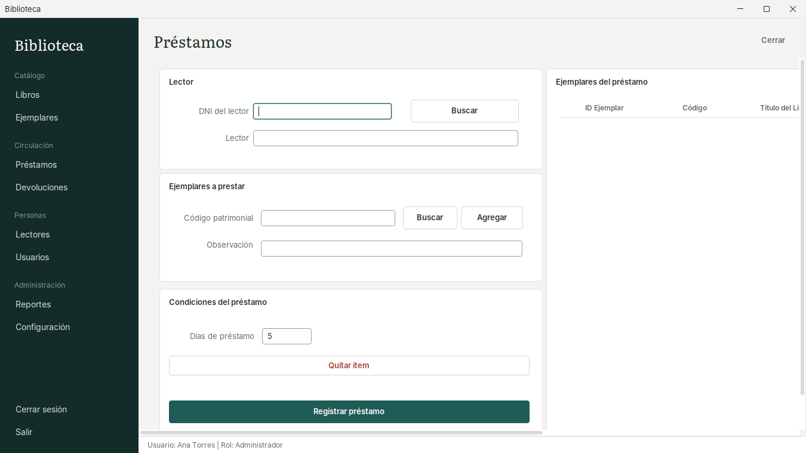
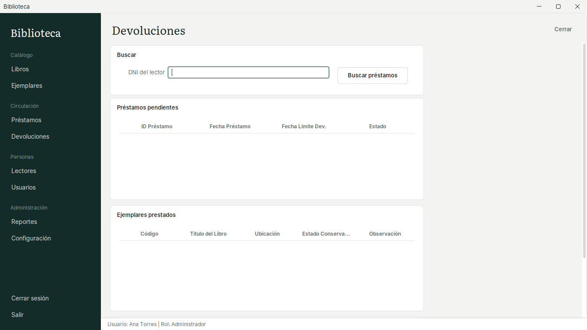
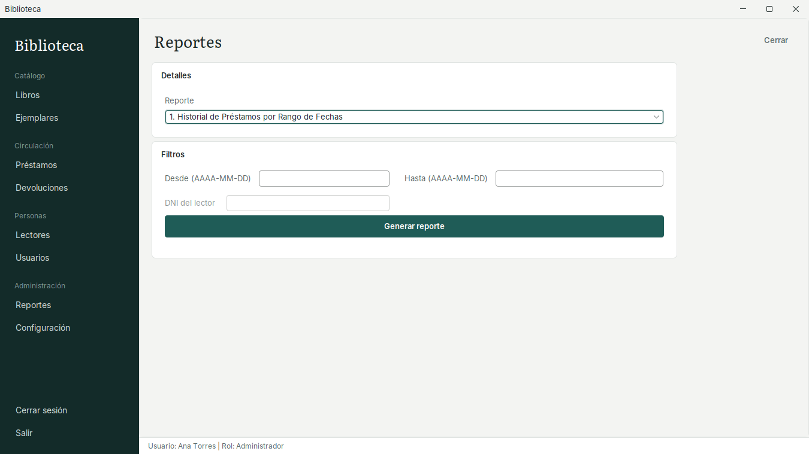
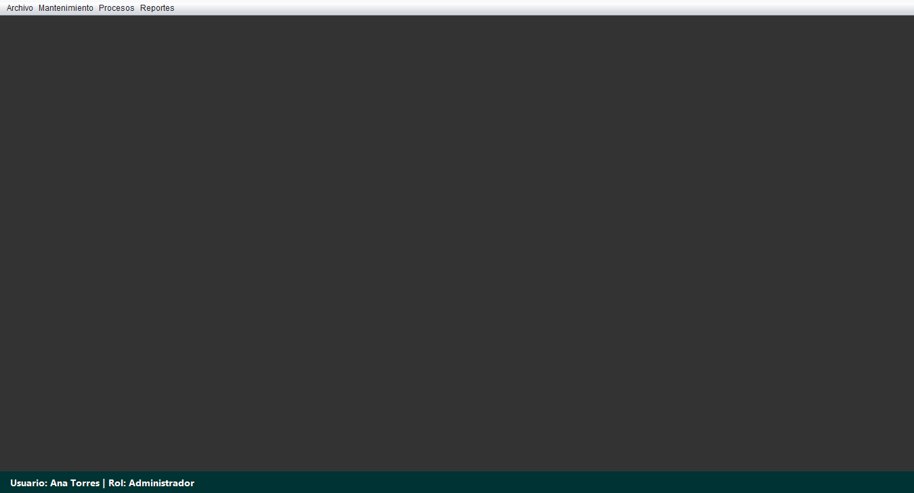
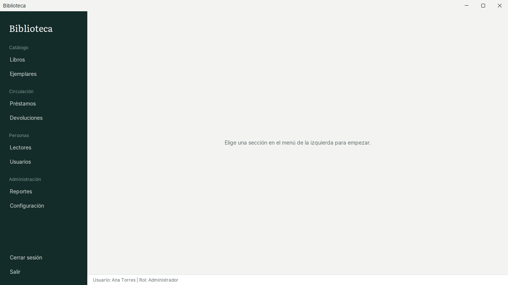

# Sistema de Biblioteca

Aplicación de escritorio para gestionar una biblioteca: catálogo de libros y ejemplares, lectores, préstamos, devoluciones con cálculo de multas y reportes exportables a PDF y Excel.

Desarrollada en **Java (Swing)** con **PostgreSQL** y una arquitectura en capas.



## Funcionalidades

- **Inicio de sesión con roles** (Administrador / Bibliotecario). Contraseñas protegidas con hash **BCrypt**.
- **Catálogo**: registro de libros por categoría y tipo de material; control de ejemplares físicos con código patrimonial, ubicación y estado de conservación.
- **Lectores**: alta, edición y búsqueda por DNI o apellidos (estudiantes, docentes y externos).
- **Préstamos**: un préstamo puede incluir varios ejemplares; se registra en una **transacción** que bloquea los ejemplares para evitar préstamos duplicados.
- **Devoluciones**: cálculo automático de días de retraso y multa según la configuración.
- **Reportes exportables a PDF y Excel**: préstamos por rango de fechas, devoluciones y multas, lectores morosos, historial por lector, libros más prestados e inventario de ejemplares.
- **Configuración** editable desde la app (días de préstamo, multa diaria).

## Tecnologías

| Área | Herramienta |
|---|---|
| Lenguaje | Java 26 |
| Interfaz | Swing + [FlatLaf](https://www.formdev.com/flatlaf/) (tema plano) |
| Base de datos | PostgreSQL + JDBC |
| Seguridad | jBCrypt |
| Reportes | OpenPDF |
| Build | Maven |

## Arquitectura

```
src/main/java
├── presentacion/   Pantallas Swing (formularios internos)
├── negocio/        Reglas de negocio y validaciones (multas, préstamos, reportes)
├── dao/            Acceso a datos con JDBC y consultas parametrizadas
├── modelo/         Entidades (Libro, Ejemplar, Lector, Prestamo, Usuario…)
├── configuracion/  Conexión a la BD y utilidades de seguridad
├── estilo/         Tema visual y barra lateral
└── excepciones/    DAOException y NegocioException
```

Cada capa solo se comunica con la de abajo: la interfaz llama a `negocio`, `negocio` valida y llama a `dao`, y `dao` es el único que ejecuta SQL.

## Base de datos

El modelo tiene 10 tablas: `libro`, `ejemplar`, `lector`, `prestamo`, `detalle_prestamo`, `usuario`, `rol`, `categoria`, `tipo_material` y `configuracion`. Incluye llaves foráneas, restricciones `CHECK` e índices para las búsquedas frecuentes.

Los scripts están en [`database/`](database):

| Script | Contenido |
|---|---|
| `01_esquema.sql` | Tablas, llaves, restricciones e índices |
| `02_datos_iniciales.sql` | Roles, configuración, categorías, tipos de material y usuarios de prueba |
| `03_datos_demo.sql` | *(opcional)* 132 títulos, 377 ejemplares, 180 lectores y 850 préstamos de un año |

### Datos de demostración

Los datos de `03_datos_demo.sql` son ficticios y los produce [`database/generador/generar_datos_demo.py`](database/generador/generar_datos_demo.py), que simula un año de préstamos día a día respetando las reglas del sistema:

- un ejemplar no se presta si ya está prestado, y los ejemplares perdidos nunca salen;
- los lectores inactivos o con préstamos vencidos no reciben préstamos nuevos;
- la multa es igual a los días de retraso multiplicados por la tarifa configurada, y el estado (`Pendiente`, `Devuelto`, `Con Retraso`) se deriva de las fechas;
- la cantidad de préstamos sigue el calendario académico, con picos en exámenes y menos actividad en vacaciones.

Para regenerarlo: `python database/generador/generar_datos_demo.py` (usa una semilla fija, así que el resultado siempre es el mismo).

## Cómo ejecutarlo

**Requisitos:** JDK 26, Maven y PostgreSQL.

1. Crea la base de datos y carga los scripts:

   ```bash
   createdb -U postgres bd_biblioteca
   psql -U postgres -d bd_biblioteca -f database/01_esquema.sql
   psql -U postgres -d bd_biblioteca -f database/02_datos_iniciales.sql
   psql -U postgres -d bd_biblioteca -f database/03_datos_demo.sql   # opcional
   ```

2. Configura la conexión copiando el archivo de ejemplo y poniendo tu contraseña de PostgreSQL:

   ```bash
   cp bd.properties.example bd.properties
   ```

   También puedes usar variables de entorno: `BD_URL`, `BD_USUARIO`, `BD_CLAVE`.

3. Ejecuta la aplicación:

   ```bash
   mvn compile exec:java
   ```

   O ábrelo en NetBeans / IntelliJ y ejecuta `com.usat.sistemabiblioteca.SistemaBiblioteca`.

4. Ingresa con un usuario de demostración:

   | Usuario | Contraseña | Rol |
   |---|---|---|
   | `admin` | `admin123` | Administrador |
   | `mlopez`, `jcastro`, `rvilchez` | `biblio123` | Bibliotecario |

## Capturas

| Inicio de sesión | Préstamos |
|---|---|
|  |  |

| Devoluciones | Reportes |
|---|---|
|  |  |

### Rediseño de la interfaz

La primera versión usaba menús clásicos de Swing; se rediseñó con FlatLaf, una barra lateral de navegación y una tipografía propia.

| Antes | Después |
|---|---|
|  |  |

## Seguridad

- Las contraseñas se guardan con **BCrypt** (costo 12), nunca en texto plano. Si una base antigua tiene claves en texto plano, se convierten a hash automáticamente la primera vez que ese usuario inicia sesión.
- Todas las consultas usan `PreparedStatement`, lo que evita inyección SQL.
- Las credenciales de la base de datos no están en el código: se leen de `bd.properties` (excluido del repositorio) o de variables de entorno.

## Autor

**Rubén Rojas** — proyecto académico, Universidad Católica Santo Toribio de Mogrovejo (USAT).

- GitHub: [@JBen-Rjc](https://github.com/JBen-Rjc)
